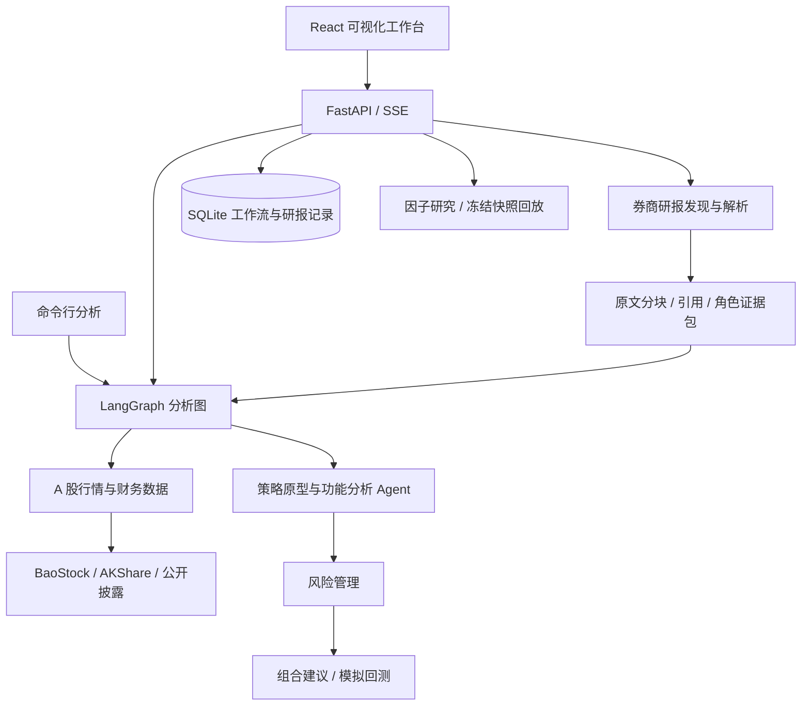

# AI Hedge Fund · A 股多 Agent 投资研究工作台

一个面向沪深 A 股的本地投资研究系统：将行情与财务数据、投资理念启发的策略原型、券商研报原文、风险评估和组合决策连接到同一套可视化工作流中，并提供命令行分析、模拟回测和策略研究工具。

项目基于 [virattt/ai-hedge-fund](https://github.com/virattt/ai-hedge-fund) 扩展，主要增加 A 股数据适配、中文研究报告、证券搜索、带引用的研报分析、因子研究、工作流运行记录以及中英文界面。

> **仓库发布状态（2026-10-10）：** 本 README 根据当前完整本地源码编写。此 GitHub 仓库目前仅发布项目说明，完整源码尚未同步；下列目录、命令和功能描述对应完整项目。仅克隆当前说明仓库无法运行系统，需先取得完整源码。上游仓库包含基础项目，但不包含这里描述的全部扩展。
>
> **用途：** 学习、数据分析和投资策略研究。系统输出分析决策并进行模拟回测，未接入券商下单接口。投资人姓名表示公开理念启发的项目策略原型，不代表本人观点、持仓、授权或背书。

## 目录

- [项目能力](#项目能力)
- [技术架构](#技术架构)
- [数据来源与覆盖范围](#数据来源与覆盖范围)
- [快速开始](#快速开始)
- [Web 工作台使用](#web-工作台使用)
- [命令行分析与回测](#命令行分析与回测)
- [策略模式与因子研究](#策略模式与因子研究)
- [券商研报智能分析](#券商研报智能分析)
- [API 概览](#api-概览)
- [存储与运行记录](#存储与运行记录)
- [Docker 与 macOS 启动](#docker-与-macos-启动)
- [项目目录](#项目目录)
- [测试与验证](#测试与验证)
- [常见问题](#常见问题)
- [当前边界与后续方向](#当前边界与后续方向)
- [来源与许可](#来源与许可)

## 项目能力

| 模块 | 当前实现 |
| --- | --- |
| A 股证券搜索 | 按股票代码、中文名称和拼音缩写搜索；证券解析区分唯一结果、歧义和未匹配 |
| 多 Agent 分析 | 12 个投资理念策略原型、6 类功能分析节点，以及风险管理和组合管理节点 |
| 可视化工作流 | 拖拽节点、连接分析链路、保存与复制工作流、选中项复制粘贴、自动布局、撤销与重做 |
| 分析结果 | 节点状态、分析理由、数据质量、关键指标、最终组合建议及相关引用 |
| 模拟回测 | 按历史日期运行分析、更新模拟组合，展示收益、风险及交易记录 |
| 研报分析 | 来源发现、全文获取、PDF/HTML/文本解析、去重、摘录、周期报告和原文引用 |
| 策略研究 | 因子贡献、证据覆盖、策略门槛、LEGACY/SHADOW 对照、快照回放和语料健康监控 |
| 运行持久化 | 已保存工作流的 Web 分析与回测记录、周期明细、错误和取消状态 |
| 模型配置 | 云模型供应商配置、模型目录同步及 Ollama 本地推理 |
| 界面与启动 | 中英文界面、主题设置、操作引导、Web/CLI/Docker 入口及本机 macOS 启动脚本 |

### 分析节点

**投资理念启发的策略原型：** 段永平、邓晓峰、冯柳、傅鹏博、朱少醒、张坤、刘彦春、谢治宇、董承非、王亚伟、陈光明、林园。

**功能分析节点：** 技术分析、基本面分析、成长分析、新闻情绪、市场情绪、估值分析。

**决策节点：** 风险管理根据数据与组合约束评估仓位边界；组合管理综合分析信号、风险信息和可用研报证据，生成结构化建议。

不同节点的数据需求和模型调用方式不同。节点名称本身不意味着所需数据必然齐全，也不意味着每个节点都会调用大模型。

## 技术架构

| 层次 | 主要技术 |
| --- | --- |
| 前端 | React 18、TypeScript、Vite、React Flow、Tailwind CSS、Radix UI、i18next |
| API 与持久化 | FastAPI、Pydantic、SQLAlchemy、SQLite、Alembic |
| Agent 编排 | LangGraph、LangChain、多供应商模型适配 |
| 数据与计算 | BaoStock、AKShare、pandas、NumPy、类型化数据契约、因子引擎 |
| 研报处理 | httpx、pypdf、BeautifulSoup、分块与引用校验 |
| CLI 与测试 | Rich、questionary、pytest、Vitest |



Web 分析与回测通过 SSE 传递进度和结果。研报刷新通过后台任务执行，前端查询任务状态。因子研究与研报分析是两条不同的研究链路。

## 数据来源与覆盖范围

日常 A 股行情和财务数据不要求另行配置金融数据 API Key。公开数据服务仍受网络、接口变化、更新频率和历史覆盖限制。

| 数据 | 来源 / 处理 | 边界 |
| --- | --- | --- |
| 日线 OHLC、成交量 | BaoStock | 兼容分析接口使用不复权价格；类型化数据层另提供复权历史能力 |
| PE / PB / PS、估值历史 | BaoStock | 不同股票与日期的覆盖可能不完整；负值或零值不能自动解释为低估 |
| 利润表、资产负债表、现金流量表 | AKShare / 新浪财经 | 根据财报披露信息过滤；字段、期间和更正记录影响历史可用性 |
| ROE、利润率、自由现金流等 | 基于可用报表字段计算 | 缺少必要输入时保留缺失，不填造数值 |
| 总股本与市值 | AKShare / 东方财富股本数据 + BaoStock 收盘价 | 市值需要有效价格与相应日期股本；严格历史披露时间存在限制 |
| 新闻 | AKShare / 东方财富及本地快照 | 近期新闻不等于完整历史新闻；严格历史请求依赖已捕获快照 |
| 定期财报原文链接 | 巨潮资讯 CNINFO | 公司法定披露文件，与券商研究报告分开处理 |
| 券商研究报告 | 东方财富研报接口与原始文档；可选授权研究 Feed | 发现元数据不等于取得全文；来源覆盖不等于全市场覆盖 |

数据层区分 `present`、`empty_success`、`provider_failure` 等状态，记录来源、时间和质量信息。严格历史查询不会把当前可见数据直接当成当时已知数据。

**历史研究注意：** 提供方事后修订的复权因子、行业分类或股本记录，可能无法还原本地首次捕获以前的版本。快照机制有助于保留之后的可见状态，但不能补造完整历史。

主金融分析链路面向沪深 A 股，建议使用六位代码，例如 `600519`、`000858`。研报层的证券契约支持其他市场标识和授权来源扩展，不代表已完成美股金融分析与全文研报覆盖。

## 快速开始

以下步骤在**完整项目源码根目录**执行。推荐 Python 3.11、Poetry 2.2.x、Node.js 18+ 和 npm；使用 Docker 时需安装 Docker Engine 或 Docker Desktop。项目 Python 依赖约束为 `^3.11`，优先选择 3.11 可减少较新 Python 版本的依赖兼容问题。

### 1. 安装依赖

```bash
# 在包含 pyproject.toml 的项目根目录执行
poetry env use python3.11
poetry install

# 前端采用已提交的依赖锁文件
cd app/frontend
npm ci
cd ../..
```

### 2. 配置模型

首次配置时，将 `.env.example` 复制为 `.env`，并填入实际使用的模型供应商凭据：

```bash
cp .env.example .env
```

例如使用 DeepSeek：

```dotenv
DEEPSEEK_API_KEY=your-deepseek-api-key
```

模板包含 OpenAI、Anthropic、DeepSeek、Google、Groq、OpenRouter、xAI、GigaChat 和 Azure OpenAI 的配置项。只需配置所使用的供应商；Azure 还需要相应 endpoint 和 deployment 配置。模板中的 `your-...` 占位符不会被当作有效凭据。

Web 设置页也可保存供应商 API Key。有有效的数据库配置时，会优先于环境配置。云模型目录按供应商凭据获取并缓存，目录可见不等于每个模型都已通过任务兼容性验证。

使用 Ollama 时不需要云模型 API Key，但仍需安装并运行 Ollama、下载模型，且需要联网获取市场数据。纯摘录型研报处理可以不调用模型；完整投资分析流程中的模型节点仍需要可用模型。

### 3. 启动 Web 服务

推荐在两个终端分别启动，便于查看日志。

**终端一：后端**

```bash
poetry run uvicorn app.backend.main:app --reload --host 127.0.0.1 --port 8000
```

**终端二：前端**

```bash
cd app/frontend
npm run dev -- --host 127.0.0.1 --port 5173
```

| 服务 | 地址 |
| --- | --- |
| Web 工作台 | http://localhost:5173 |
| 后端 API | http://localhost:8000 |
| Swagger API 文档 | http://localhost:8000/docs |
| 健康检查 | http://localhost:8000/ping |

也可从根目录运行 `bash app/run.sh`，由脚本检查环境、安装依赖并启动服务。手动方式更容易区分环境问题和应用问题。

当前后端 CORS 允许本地 5173 前端。部分前端服务仍固定访问 `http://localhost:8000`，`VITE_API_URL` 尚未统一覆盖所有客户端；更换端口或远程部署需检查这些调用地址。

## Web 工作台使用

### 分析与回测

1. 创建或选择工作流，并保存工作流。
2. 添加组合起始节点、分析节点、风险管理与组合管理节点，按需连接。
3. 通过证券选择器设置股票，配置日期、资金和模型。
4. 执行分析，在节点状态及底部输出区查看进度、理由、数据质量和最终报告。
5. 需要历史模拟时，切换回测设置并运行；已保存工作流的请求会关联运行历史。

画布提供节点选择、复制粘贴、复制选中项、自动布局、连接删除、右键菜单、撤销与重做。模型、API Key、主题和语言配置位于设置区域。

### 策略研究工作台

上方入口打开研究工作台，提供四个视图：

- **研报分析：** 选择证券与日期范围，刷新报告、查看任务进度和原文引用。
- **股票策略分析：** 查看投资原型、因子贡献、证据覆盖与策略门槛。
- **语料库健康监控：** 查看快照覆盖、信号与置信度分布、数据与因子漂移提示。
- **快照历史与回放：** 查看已捕获快照与对应的研究结果。

界面包含中英文资源，但部分新增研报文字仍为中文；当前不宣称所有页面已完全双语化。

## 命令行分析与回测

### 单次分析

```bash
poetry run python src/main.py --tickers 600519,000858
```

未指定分析节点或模型时，CLI 会提供交互选择。

```bash
# 指定分析节点，并展开分析理由
poetry run python src/main.py \
  --tickers 600519 \
  --analysts duan_yongping,fundamentals_analyst,valuation_analyst \
  --start-date 2026-09-01 \
  --end-date 2026-09-30 \
  --initial-cash 100000 \
  --show-reasoning

# 使用全部可选分析节点
poetry run python src/main.py --tickers 600519 --analysts-all

# Ollama 本地模型
poetry run python src/main.py --tickers 600519 --ollama

# 排查诊断信息；完整图状态使用 --debug-state
poetry run python src/main.py --tickers 600519 --debug

# 查看实际支持的参数
poetry run python src/main.py --help
```

分析结果以 Rich 结构化展示。`--show-reasoning` 展开理由，`--debug` 显示诊断信息，`--debug-state` 导出完整图状态。日期示例只是参数示范，不代表该区间的数据源当前一定可用。

### 模拟回测

```bash
poetry run backtester \
  --tickers 600519,000858 \
  --start-date 2026-09-01 \
  --end-date 2026-09-30 \
  --initial-capital 100000 \
  --analysts duan_yongping,fundamentals_analyst

poetry run backtester --help
```

回测器会交互选择模型。其参数与单次分析 CLI 并不完全一致，请以各自的 `--help` 为准。

模拟结果包含组合价值、交易记录及收益/风险指标。代码存在通用多空模拟结构，但这不代表已完整建模 A 股 T+1、涨跌停、融券可得性、手续费和滑点，也不代表历史模拟结果可以直接用于实盘。

## 策略模式与因子研究

`A_SHARE_INVESTOR_MODE` 控制投资原型的评估路径，默认是 `legacy`。

| 模式 | 行为 |
| --- | --- |
| `legacy` | 默认策略路径，沿用原有指标评分和分析输出 |
| `shadow` | 保留 LEGACY 决策信号，并附加支持策略的因子研究结果；SHADOW 结果不替代主决策 |
| `new` | 仅张坤、冯柳、傅鹏博三个试点原型可进入新因子决策路径；其他原型保持 LEGACY |

```bash
A_SHARE_INVESTOR_MODE=shadow poetry run python src/main.py \
  --tickers 600519 --show-reasoning
```

当前有 10 个因子研究原型：张坤、冯柳、傅鹏博、段永平、邓晓峰、朱少醒、刘彦春、谢治宇、董承非、陈光明。

王亚伟与林园的因子研究版本为 `NOT_READY`：分别缺少重组/资金流相关证据及垄断壁垒/定价权相关代理。原有 LEGACY 原型仍存在；不会为缺失维度伪造新因子结果。

因子引擎展示因子值、贡献、覆盖、质量及置信度限制。**置信度表示当前判断的数据和证据支撑程度，不是上涨概率、盈利概率或交易胜率。**

冻结快照支持在同一输入上进行 LEGACY/新策略对照与离线回放。采集和监控入口：

```bash
poetry run collect-shadow-snapshots --tickers 600519 000858
poetry run shadow-corpus-summary --json
```

快照采集包含实际数据访问并写入本地文件；监控命令读取既有语料。默认目录位于 `docs/baselines/shadow/live/`。采集脚本不等于自动定时任务，需另行安排运行频率。

## 券商研报智能分析

### 处理流程

证券解析 → 来源发现 → 原文获取 → PDF/HTML/文本解析 → 日期校验与去重 → 长期保存 → 可验证摘录 → 周期汇总 → 引用展示 → 工作流角色证据包。

- 支持周、月、年及自定义日期区间；滚动周期按代码中的日历规则解析。
- 区分网站登记日期与 PDF 正文日期，保留来源、机构、作者、原始评级与文档身份。
- 引用包括来源、页码、chunk ID 和原文摘录，页面可展示证据及原始文档链接。
- 可展示盈利预测、目标价、主题、催化剂、风险与变化等字段；实际内容取决于原文与校验结果。
- 仅有一家机构或少量报告时，不将其包装为全市场共识。
- 缺少可用证据时，问答返回 `INSUFFICIENT_EVIDENCE`。

单篇处理默认使用可核实摘录；开启 `use_llm` 后，可使用现有模型抽取分块内容，再校验引用与摘录约束。逐字引用校验不是完整语义验证，复杂表格与多列文本仍需结合原始 PDF 判断。

### 来源与缓存

默认适配器为东方财富个股研报。可配置提供结构化元数据和合法原文链接的研究 Feed：

```dotenv
RESEARCH_FEED_URL=https://your-authorized-provider.example/research
RESEARCH_DOCUMENT_HOSTS=your-authorized-provider.example,pdf.your-provider.example
```

Feed 需遵守 `ResearchReportMetadata` 契约及来源准入规则；搜索结果摘要不会被当作研报全文。东方财富详情页回退内容会标记为摘要，与完整 PDF 区分。

发现结果及周期摘要缓存约 6 小时，文档原始内容、解析分块与单篇处理结果长期保存。缓存身份包含来源、内容哈希和相关解析/模型版本，刷新不意味着对已保存原文反复下载。

下载限制为单文档 20 MB、PDF 300 页、解析文本 100 万字符。任务执行器为本地有限线程池，带队列上限、状态记录和中断恢复，不是分布式任务系统。

### 工作流中的研报证据

基本面、风险和组合节点接收各自相关的精简证据包；技术节点不接收研报全文。机构观点保留来源身份，与事实数据、项目推断分开标记。

支持独立网页研报处理和图入口的预分析接入。预分析接入不等于任意工作流运行必然获取到全部研报；是否有结果取决于证券、区间、来源可达性和请求配置。

## API 概览

以运行中的 `/docs` 为完整接口说明；下表列出主要入口。

| 方法 | 路径 | 用途 |
| --- | --- | --- |
| GET | `/ping` | 健康检查 |
| POST | `/hedge-fund/run` | SSE 分析执行 |
| POST | `/hedge-fund/backtest` | SSE 模拟回测 |
| GET | `/hedge-fund/agents` | 可用分析节点 |
| GET / POST | `/flows/` | 工作流列表与创建 |
| GET | `/flows/{flow_id}/runs/` | 工作流运行列表 |
| GET | `/flows/{flow_id}/runs/{run_id}/cycles` | 周期明细分页查询 |
| GET | `/api/securities/search` | 证券搜索 |
| GET | `/api/securities/resolve` | 证券解析 |
| GET | `/language-models/` | 模型目录 |
| GET | `/api-keys/status` | 凭据配置状态 |
| GET | `/api/research/stocks/{ticker}` | 股票策略研究概览 |
| GET | `/api/research/corpus/summary` | 快照语料健康 |
| POST | `/api/research/intelligence/stocks/{query}/refresh` | 创建研报处理任务 |
| GET | `/api/research/intelligence/tasks/{task_id}` | 任务状态与结果 |
| GET | `/api/research/intelligence/stocks/{query}/summary` | 已缓存周期报告 |
| GET | `/api/research/intelligence/reports/{report_id}` | 研报文档详情 |
| POST | `/api/research/intelligence/stocks/{query}/answer` | 基于已有报告的受限问答 |

证券搜索示例：

```bash
curl 'http://localhost:8000/api/securities/search?q=600519&limit=10'
```

创建不调用大模型的自定义区间研报任务：

```bash
curl -X POST \
  'http://localhost:8000/api/research/intelligence/stocks/600519/refresh' \
  -H 'Content-Type: application/json' \
  -d '{"period":"custom","start":"2026-09-01","end":"2026-09-30","use_llm":false}'
```

该操作会访问研报来源并写入本地缓存，返回任务信息；之后使用返回的 `task_id` 查询进度。空缓存直接查询 summary 会返回 404，应先创建刷新任务。

## 存储与运行记录

| 存储 | 内容 |
| --- | --- |
| `app/backend/hedge_fund.db` | 工作流、API Key 设置、模型目录缓存、运行记录与研报文档/任务 |
| `DATA_SNAPSHOT_DB` 指定路径（如 `data/snapshots.sqlite3`） | 配置启用后的数据层本地时间点快照归档 |
| `docs/baselines/shadow/live/` | 因子研究冻结快照、评估结果和时间目录 |
| `.run/` | 本机 macOS 启动日志与进程记录 |

本地数据快照归档需要显式配置 `DATA_SNAPSHOT_DB`，未配置时不会默认创建该 SQLite 归档。

已保存工作流的 Web 请求携带 `flow_id`，关联 `hedge_fund_flow_runs` 与 `hedge_fund_flow_run_cycles`。不携带 `flow_id` 的独立 API 请求保留兼容行为，CLI 不写入这组 Web 运行历史表。

运行状态为 `IN_PROGRESS` → `COMPLETE`、`ERROR` 或 `CANCELLED`。回测记录完成周期；发生分析错误时停止并保留之前周期。启动恢复会将遗留未完成运行标为错误，不补造成功结果。恢复逻辑按本地单后端进程设计。

取消请求会终止流并保存取消状态，但已在线程中开始的同步模型或数据请求可能运行到自身结束。终止记录不会被迟到结果覆盖。

结构化运行记录会移除 API Key/Token 字段；设置数据库本身仍含 API Key 配置。备份应涵盖实际需要的数据库和快照目录，避免公开上传 `.env` 或设置数据库。删除工作流会级联删除关联运行与周期。

## Docker 与 macOS 启动

### Docker CLI

```bash
# 从项目根目录构建
docker compose build app

# 容器内启动交互式分析
docker compose run --rm app python src/main.py --tickers 600519
```

### Docker Web 后端

```bash
docker compose -f compose.web.yaml up -d --build web-backend
```

`compose.web.yaml` 启动 API 后端，不包含 React 前端容器。前端仍需在 `app/frontend` 中安装依赖并启动。

Ollama 作为可选 `embedded-ollama` profile：

```bash
docker compose -f compose.web.yaml --profile embedded-ollama up -d --build
```

使用宿主机 Ollama 时，需设置容器可达的 `OLLAMA_BASE_URL`。Docker Desktop 常用 `http://host.docker.internal:11434`；容器内 `localhost` 指向容器自身。当前配置没有为 Web SQLite 配置持久卷，需自行安排挂载和备份。镜像默认不安装 dev/test 依赖。

### macOS 本机入口

项目包含 `scripts/build_app.sh`、`scripts/macos_launcher.sh` 和 `scripts/stop_services.sh`，用于生成应用入口、检查并启动本地服务及停止服务。

这些脚本当前绑定开发者本机项目路径，打包脚本还会替换同名应用。它们是本机辅助脚本，不是可直接在任意 Mac 上运行的通用安装包。使用前需检查 `PROJECT_ROOT`、依赖路径和应用目标；通用运行方式仍是前述手动 Web 启动。

## 项目目录

```text
.
├── src/
│   ├── main.py                 # 分析入口与 Agent 图
│   ├── agents/                 # 投资原型、功能分析、风险与组合节点
│   ├── data/                   # 数据契约、能力、路由、缓存、快照和证券主表
│   ├── tools/                  # 兼容数据接口、A 股适配、财报引用
│   ├── factors/                # 因子定义、加载与评估引擎
│   ├── investors/              # 策略配置、SHADOW 对照、时间回放与监控
│   ├── research/               # 券商研报发现、解析、引用与存储
│   ├── llm/                    # 模型供应商与凭据解析
│   ├── backtesting/            # 模拟组合、交易执行与绩效计算
│   └── cli/                    # 参数、元数据、日志和 Rich 输出
├── app/
│   ├── backend/
│   │   ├── main.py             # FastAPI 入口
│   │   ├── routes/             # 分析、工作流、模型、证券与研究 API
│   │   ├── services/           # 图执行、模型目录、回测、研报和运行记录
│   │   ├── repositories/       # 工作流与运行记录访问
│   │   ├── database/           # SQLAlchemy 连接和模型
│   │   └── alembic/            # 数据库迁移
│   └── frontend/src/
│       ├── components/         # 画布、研究视图、面板、设置和引导
│       ├── nodes/              # React Flow 节点与分析报告
│       ├── services/           # API 客户端、剪贴板与布局
│       ├── hooks/              # 历史、快捷键和工作流交互
│       ├── i18n/               # 中英文资源
│       └── tests/              # 前端行为测试
├── data/security_master.json   # 本地证券搜索主表
├── docs/                       # 数据边界、因子研究、实现说明与验收材料
├── scripts/                    # 验证、截图、快照对照和本机启动工具
├── tests/                      # 数据、Agent、研报、持久化与回测测试
├── docker/                     # Dockerfile 与辅助脚本
├── compose.yaml                # CLI / 可选服务配置
├── compose.web.yaml            # Web 后端 / 可选 Ollama 配置
├── pyproject.toml              # Python 依赖与 CLI 入口
└── .env.example                # 环境配置模板
```

## 测试与验证

文档对应当前代码，不构成每个数据源、模型或部署方式在所有环境下均已通过验收的保证。

```bash
# Python 测试
poetry run pytest -q

# 按模块验证
poetry run pytest -q tests/test_report_intelligence.py
poetry run pytest -q tests/test_flow_run_persistence.py
poetry run pytest -q tests/test_factor_engine.py tests/test_investor_profiles.py
poetry run pytest -q tests/backtesting

# 依赖声明校验
poetry check

# 前端测试与生产构建
cd app/frontend
npm test
npm run build
```

Python 测试覆盖数据状态与历史边界、因子/策略语义、LLM 响应、冻结对照、工作流持久化、研报引用和回测等。部分测试使用临时 SQLite、固定样本和模型/行情替身，验证软件契约；这些结果不能代替真实供应商与模型的联网验收。

`docs/baselines/` 保存历史运行与回放证据；具体股票、日期、报告数量、测试数量和耗时仅代表各自记录时点。`scripts/verify_report_*.py`、`scripts/check_a_share_sources.py` 等实际来源/模型验证工具应先检查配置，调用模型可能产生费用。

本次 README 整理已遍历源码结构、核对接口与路径，实际执行了分析 CLI / 回测 CLI 的 `--help` 及 `poetry check`。依赖声明校验通过，但 Poetry 提示现有元数据写法弃用；本次没有重新执行全套测试、真实行情分析或模型联网验收。

## 常见问题

| 现象 | 检查方向 |
| --- | --- |
| 克隆仓库后找不到 `pyproject.toml` | 当前 GitHub 说明仓库还未发布完整源码，先取得完整项目 |
| 页面可以打开，但分析失败 | 继续检查实际模型配置、行情可达性、股票代码和后端错误状态 |
| `.env` 已填 Key，仍提示未配置 | 确认不是 `your-...` 占位符；Web 数据库里的有效配置可能覆盖环境值 |
| 模型列表为空或刷新失败 | 检查供应商 Key、权限、网络和模型目录请求；Ollama 需运行并下载模型 |
| 图表为空、指标缺失 | 查看 `provider_failure`、历史覆盖、披露时间与字段缺失；不把缺失解释为零 |
| 研报数量少或无全文 | 查看证券、日期区间、来源、摘要/全文状态与下载错误；少量结果不代表完整覆盖 |
| 回答为 `INSUFFICIENT_EVIDENCE` | 原文或引用不足，需补充有效来源，不应让模型猜测 |
| 运行历史为空 | 保存工作流后执行；检查请求是否携带 `flow_id`，CLI 不写入 Web 历史 |
| 股票策略显示 `NOT_READY` | 部分策略缺少必要维度；这与已有 LEGACY 原型是否存在是不同状态 |
| 修改后端端口后部分页面失效 | 检查固定 `localhost:8000` 客户端与 CORS，不能只修改 `VITE_API_URL` |
| 8000 / 5173 被占用 | 先确认占用进程和项目，再选择停止对应服务或修改配置 |

## 当前边界与后续方向

- 未接入券商订单执行；回测也未完整还原 A 股全部交易约束。
- 数据支持受公开来源覆盖与时效影响，不提供全市场、全历史完整性承诺。
- SHADOW 研究状态不是实盘就绪、准确率或收益保证，`new` 路径仍限制在三个试点原型。
- 研报尚无 OCR、完整向量检索或分布式队列；扫描、加密、超限文档会失败或无法得到有效全文。
- 多列 PDF 和跨页表格可能影响语义；严格摘录并不等于跨报告自由综合已通过语义蕴含校验。
- 美股研报依赖合法可用来源扩展，不能从标识支持推断完整美股数据支持。
- 后端按本地单用户工具设计，当前没有完整用户认证与多租户隔离；远程部署需补齐访问控制、API 地址和存储配置。
- macOS 打包和部分启动路径尚待通用化；Docker Web 配置尚需前端容器与持久卷配套。

后续优先方向包括：稳定授权研报来源、OCR/表格质量判定、跨机构语义验证、严格历史数据积累、部署配置统一以及更完整的模拟交易约束。

## 来源与许可

原始项目：[virattt/ai-hedge-fund](https://github.com/virattt/ai-hedge-fund)。此版本围绕 A 股、本地研究与可追溯证据进行扩展。

上游 README 声明 MIT 许可，前端保留了其所用模板的 MIT 许可文件 `app/frontend/LICENSE`。当前完整本地项目根目录未包含独立 LICENSE 文件，发布和再分发源码前应核对并保留上游及各依赖的适用许可与版权声明，不能将前端模板许可直接视为所有文件的完整授权依据。

本项目的模型输出、策略名称与历史回测仅用于学习和研究，不构成投资建议。
