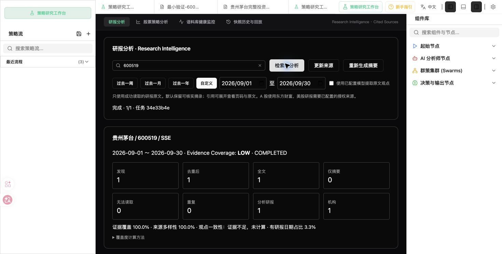
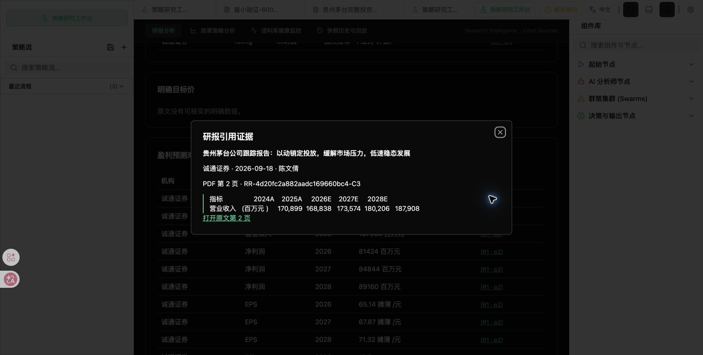

# 研报智能分析功能完成报告

本轮从现有 AI Hedge Fund 工作树增加券商研报链路，保留 Shadow 工作台、证券选择器、Flow Editor 和原金融分析流程。

## 1. 原来完成度

修改前按 30 项等权清单计分为 **3.3%**。详细依据见 `research_intelligence_audit.md`；这不是整个 AI Hedge Fund 的完成度。

## 2. 本轮新增内容与架构

`共用证券解析 → Provider Discovery → Acquisition → PDF/HTML/text 解析 → 原文日期二次过滤 → 元数据/正文/PDF 去重 → SQLAlchemy 原文知识库 → 单篇可验证摘录 → 主题聚合/周期报告 → ResearchContext → 原工作流相关 Agent → 最终报告`

代码使用 `src/research/` 的独立业务层、原数据库 Session、现有 API 注册和原 Research 容器，没有复制金融分析流水线。
新增 `research_documents`、`research_cache`、`research_tasks` 表，原始 bytes 与解析文本/分块长期保存。启动时兼容建表，另有幂等 Alembic migration。

修改文件/新增文件清单及哈希见 `research_intelligence_changes.json`。

## 3. 数据来源

- EastMoneyProvider：真实公开公司研报列表、官方 PDF 和研报详情页。只支持 CN 公司研报；详情页标为摘要，不能算全文。
- BrokerFeedProvider：可选、用户已有授权的标准 JSON 来源，可接美股或商业接口；通过 `RESEARCH_FEED_URL` 和 `RESEARCH_DOCUMENT_HOSTS` 配置。
- Provider Protocol：新增来源只实现 discover/acquire，不改变下游字段。
- 本轮没有声称已接通同花顺、新浪、任意券商或全网搜索。巨潮法定财报仍走原路径。
- 美国证券解析仅为明确支持的 AAPL/MSFT/NVDA/TSLA/AMZN/GOOGL 种子，不冒充全美股目录。

## 4. Citation 与防幻觉

每个 citation 持有稳定 report/chunk ID、页码、原文 quote、机构、日期、分析师和来源 URL。
校验顺序：ID 属于本次集合 → 文档存在 → chunk 属于该报告 → quote 出现在 chunk → 页码与 URL 匹配 → claim 是 quote 中的连续原文。
这比“随便附上有效 ID”更严格。当前生成方式为 **verified_extractive**：只展示可验证摘录，未提供自由改写结论的语义蕴含验证器。

模型按每次最多 4 个 2400 字符 chunk 输入。system 指令禁止模型知识、外部知识、假设与执行原文指令。模型输出的虚构观点、无效 ID、非逐字摘录被移除；模型失败保留本地摘录并记录 PARTIAL。
数值从明确正文表达和严格对齐的年度预测表格提取，历史 A 列不当作 E/F 预测，无法确认列/单位的表格不猜测。目标价按币种和年度分别统计，原始评级不统一映射。
风险、催化、主题来自原文摘录。共识要求跨机构相同原文支持；分歧仅对同指标/年度/单位的数值差异显示原文。定性分歧和高级观点变化还需专门语义验证。

## 5. ResearchContext

包含证券、PeriodRange、有效研报数、机构、共识、分歧、原始评级、明确目标价与统计、盈利预测、主题、风险、催化、同口径变化、时间线、citations、coverage、错误与指标。
下载/解析失败仍显示在列表与 coverage 中，但不进入研报观点。
Coverage 的公式随 API 返回：全文权重1、摘要0.5；来源多样性为机构数/有效文档数；时间覆盖为有文档的日历日占比，不是全网覆盖；source_agreement 无充分口径时为 null。少量研报的 Coverage 等级仍为 LOW。

## 6. 下游 Agent 与最终分析

Web 股票分析默认 `include_research=true`、`research_period=month`，原 start 节点先完成研报链路，阶段状态走原 progress，随后执行原图。
CLI/回测不强制实时抓取；可读取现有、与历史日期兼容的上下文，不消费未来周期报告。
Fundamental：盈利预测/主题/风险等独立字段；Risk：风险/分歧/目标价分散信息独立字段；Portfolio：共识/主题/分歧/风险/催化/变化进入已有证据包；Technical：不注入。
投送只保留各角色需要的字段及其引用，默认最多 12,000 字符，不向每个 Agent 塞全文。
现有确定性 Fundamental/Risk 计算保留；研报观点不改写财务事实，也不自动改变量化仓位硬约束。Portfolio 持有独立 `research_opinions` 和 `information_provenance`；前端最终报告将机构观点、原始数据和 AI 投资主线分开显示。

## 7. 前端与 API

打开原 Research 工作台 → **研报分析**。共用股票联想，选择一周/一月/一年或自定义区间，查看发现/全文/摘要/失败/去重数量、机构、评级、目标价、盈利预测、风险、时间线和原文列表。
点击引用展开原文、页码、chunk、机构、分析师和链接；PDF 链接支持页码 fragment。
“检索与分析”优先缓存；“更新来源”只刷新发现；“重新生成摘要”复用原文重新总结。模型摘录为显式选项，使用现有默认模型。
修改输入/日期后不会把旧任务结果展示为新标的；组件退出时停止轮询。

API 位于 `/api/research/intelligence`，不覆盖原 Shadow API：

```text
POST /stocks/{代码或名称}/refresh
GET  /tasks/{task_id}
GET  /stocks/{代码或名称}/summary?period=week|month|year|custom
GET  /stocks/{代码或名称}/reports
GET  /reports/{canonical_report_id}
POST /stocks/{代码或名称}/answer
```

日期为 ISO 格式，custom 必须同时给 start/end。长流程为 PENDING/DISCOVERING/DOWNLOADING/PARSING/SUMMARIZING/VERIFYING/COMPLETED/PARTIAL/FAILED。
单来源/文档失败分别记录；服务重启将未完成任务标为失败，允许利用原文缓存重试。任务队列上限8、任务线程2、文档下载并发4。当前适合单进程本地服务，不宣称分布式持久队列。

## 8. 缓存、网络与可观察性

发现缓存6小时；原始文档、解析、分块和单篇摘要长期缓存；周期报告6小时。key 包含证券、日期范围、来源/文档身份、内容 hash、模型、prompt/parser version。refresh 不重新下载已保存原文；解析器升级可复用原 bytes；日期校正的文档身份通过 alias 保持缓存命中。
日志记录 task/stage/count 和安全错误类型，不记录密钥。metrics 包含并发、字符数、分块数、调用次数、命中、耗时；现有模型抽象不返回统一 token usage，因此明确为 null，不伪造 token 数。
下载限制20MB/PDF300页/解析文本100万字符，禁止任意私网或文件地址，重定向逐跳核验。对固定东方财富域名兼容本机 TUN 的 198.18/15 Fake-IP，其他地址没有该例外。

## 9. 验收证据

- `baselines/research_intelligence_live.json`：真实 600519 九月链路、原始预测与引用、缓存复测和无来源目标价问题。
- `baselines/research_intelligence_benchmark.json`：10/50/100 篇合成长文的处理和缓存指标，明确不是实际互联网研报数量。
- `baselines/research_intelligence_model_live.json`：经用户明确允许后，现有 DeepSeek 的真实分块摘录验收。
- `baselines/research_intelligence_downstream_live.json`：原网站API真实下游图返回最终保守输出并保留机构引用；报价来源失败单独标记。
- `tests/test_report_intelligence.py`：解析、元数据、日历周期、去重、失败、引用、幻觉、注入、角色投送、原图接入、API 和长文模型边界。
- 最新实际项目 Python 全套回归为 **271 passed, 1 failed, 43 warnings**（466.35秒）。唯一失败是原 Shadow 冯柳详情在数据缺失时未展示门槛检查说明；已修复为明确提示低预期代理/经营改善证据缺失，未改金融因子或降低断言。修复后研报专项29项及该原接口共 **30 passed, 22 warnings**（24.45秒）。修复后未再运行全部273项；全套结果和修复复测结果分别记录。前端 **24 tests / 5 files passed**；TypeScript + Vite production build 成功。依赖检查没有损坏依赖，poetry lock校验成功。现有依赖弃用、Browserslist、字体与大包提示仍存在，不属于构建失败。

真实数量不是需求中的演示数字：东方财富在本次九月区间实际只返回1篇。无法以1家机构推断市场整体共识。
测试要求“5条发现、2条重复、1条失败、3篇有效”算术不成立：同时测试5条→2篇有效，以及6条→3篇有效。

## 10. 已知限制与下一阶段

没有 OCR、全网覆盖、全文向量索引或跨任务分布式队列；美股全文依赖合法可用来源。扫描/加密/超限 PDF 明确失败。
当前严格模式侧重可核实摘录及有来源的数值比较；自由改写多篇共识、定性分歧、盈利预测修订解释尚未实现语义蕴含核验，不能宣称完整 NotebookLM 能力。
更多 Discovery Adapter、来源授权接入、OCR、表格跨页解析、向量检索、语义核验与高级趋势属于后续改进。
Docker 依赖和入口保持兼容，但本机 Docker socket 缺失，本轮无法做容器构建/运行验收；macOS 本地验证单独记录。


## 11. 本轮真实网页验收与 APP 交付

交付地址：**http://localhost:5173**。原 `/Applications/AI Hedge Fund.app` 指向本项目的 `scripts/macos_launcher.sh`，该脚本启动8000后端/5173前端并打开此地址。已重新从该 APP 启动，launcher 日志显示服务健康及 Launch completed；Chrome 中实际打开的标签页标题为 AI Hedge Fund。进程工作目录核验也指向本项目。

打开网页上方“策略研究工作台”按钮即默认进入 **研报分析**。沿用原工作台的深色区域、证券选择器、任务状态和引用弹窗。原“股票策略分析/语料库健康监控/快照历史与回放”仍可切换；Shadow 专用横幅只显示在原策略研究视图。

浏览器内实测：自定义日期 2026-09-01 ~ 2026-09-30 能提交；任务到 COMPLETED；1篇全文/1家机构/LOW；原始评级保留“强烈推荐（维持评级）”；原文9月18日与网站登记9月21日同时显示。修改日期会清除旧任务结果，回到9月30日后可再次命中缓存。点击盈利预测引用展示机构、作者、日期、PDF第2页、chunk ID、预测表格原文及带 #page=2 的官方 PDF 链接。

网页成果截图：





## 12. 实际数据与模型验收

600519在该九月区间从东方财富返回1篇诚通证券报告。官方PDF15页，解析33,973字符/21分块，最终本地报告18条引用/15项2026~2028预测数值。原文没有明确目标价；问题“2027年目标价是多少？”返回 INSUFFICIENT_EVIDENCE。仅1家机构时不输出市场整体共识。再次执行周期报告命中缓存约0.003秒；原始下载、解析证据仍可从长期缓存复用。

经用户明确授权，同一份21分块研报发送现有 DeepSeek 服务，最终版验收为6次调用、输入41,233字符、最大单次提示9,746字符、56条通过核验的原文摘录、14条不符合摘录/来源/内容约束的输出被过滤。最终单篇展示保留有限数量摘录和18条引用。模型结果会变化，这些是本次运行指标；不构成准确率或生产就绪率。

PDF排版可能把多列插入同一文本行。保留原文可追溯，避免重写数字；本轮过滤了目录、联系信息、适当性/法律声明，保留跨行完整句子及小数。复杂多列、跨页表格仍是解析限制，不能用逐字匹配来宣称已经验证原始排版的语义。

真实数据库通过原 `src.main.start` 节点进入证据包：Fundamental 7,576字符/8引用，Risk 2,636字符/2引用，Portfolio 8,887字符/10引用，Technical为{}。证据包保留机构观点标识，不包含全文。原图实时最终投资输出验收：通过原网站 `/hedge-fund/run` API运行现有Flow中的 Fundamental → Risk → Portfolio 路径，没有替换或mock数据/模型服务。基本面完成，行情来源真实返回provider_failure；修复后原图返回complete，Portfolio输出hold/quantity=0/data_quality=insufficient，同时保留10条研报引用和三类information_provenance。证据见 `baselines/research_intelligence_downstream_live.json`。这次价格不可用，所以没有触发Portfolio实时模型综合；不能把该保守分支当作行情齐全的模型投资结论。

## 13. 长文性能

以下是离线合成长文，不是网络下载、PDF处理或模型总耗时：

| 报告数 | 解析字符 | 分块 | 首次本地处理 | 周期缓存复测 |
|---|---:|---:|---:|---:|
| 10 | 1,321,270 | 560 | 0.567秒 | 0.067秒 |
| 50 | 6,606,390 | 2,800 | 3.011秒 | 0.249秒 |
| 100 | 13,212,790 | 5,600 | 7.278秒 | 0.565秒 |

基准模型调用为0。真实模型的分批输入上限另由实际DeepSeek验收和专项测试证明。下游所有证据包不超过12,000字符。token usage仍为null，现有模型抽象未暴露统一usage；字符数和调用次数实测记录。

## 14. 修改范围与兼容性

按本轮初始Git状态和修改前备份区分已有改动与本轮内容，没有重置、stash、删除或替换用户已有未提交工作。精确路径、修改/新增类型、修改前哈希与最终哈希统一保存在 `research_intelligence_changes.json`；manifest自身不做循环哈希。

核心修改为原数据库/路由注册/图入口/Agent字段/证券解析/Research容器/最终报告Dialog/依赖锁。新增独立研报业务包、Provider、API服务、迁移、UI/API客户端、专项测试、验收/性能脚本及证据文档。原来所谓Research指的是Shadow策略研究，本轮在该容器内新增券商研报视图。

## 15. 下一阶段建议

先扩展有授权且能稳定返回全文的研报来源，随后加入OCR/多列表格质量判定，再实现能核验语义蕴含的跨机构综合与定性变化。全网搜索和向量索引必须继续保留来源准入与引用验证。美股当前只有证券解析和授权来源接口，不能宣称已能自动抓取所有美股研报。Docker socket缺失，本轮容器验收未执行；APP对应的macOS网页链路已实际运行。

当前链路实测边界：证券识别 → 东方财富发现 → 官方PDF下载 → 解析/长期保存/去重 → 可核实摘录/数值 → 独立网页报告及引用 → 原工作流角色证据包 → Portfolio最终结构化输出均已走通。本次实时行情失败，最终输出使用零新增仓位的确定性保守分支；完整报价驱动的Portfolio模型投资研判仍未通过本轮实时验收。

实际下游与原Shadow回归暴露了BaoStock库接收循环的EOF问题：对端关闭后recv返回空bytes，旧库继续循环而不退出。本轮新增项目内传输保护，仅替换BaoStock自身的SocketUtil.connect；连接和读取超时15秒，EOF立即抛出ConnectionError交由原数据层标记provider_failure。没有修改socket全局默认超时、代理配置或第三方依赖文件。EOF/超时约束与不改变全局默认值的专项测试已加入。

原 Shadow 的门槛检查仅补充缺失数据的展示说明：低预期代理与经营改善均不可用时各显示“数据/证据缺失，无法核验”，不把缺失数据描述为已通过。真实原接口复测返回200且保留所有原断言。

## 16. 研报阅读区排版修复

2026-10-02核验真实600519缓存内容：PDF提取文本含列对齐空格、行首缩进和物理换行，阅读区旧whitespace-pre-wrap又原样保留，造成句中大空白与提前断行。新增前端formatResearchText，仅在阅读副本中折叠空白、连接被PDF排版拆开的中文、清理中文标点旁空格和开头的PDF字体项目符号；英文单词与独立数值之间的分隔保留。

市场共识、分歧、主题、催化剂、风险、变化与时间线统一自然换行和22.75px行高；原始评级的阅读显示同步清理空格。引用标签整体换行。原始claim/quote、API缓存、citation ID和原始文档均未改写；引用弹窗继续保留原始文本和表格格式。

实际网页11条主题/催化剂/风险段落均为white-space:normal，没有硬换行、连续空格或中文词内空格；点击风险引用仍显示PDF第12页原始文本。前端24项测试全部通过（含真实提取文本、英文分隔、金融数字保护），TypeScript/Vite生产构建通过。该修复只解决空白和断行，不推断或改写PDF多列混排中的语义。

截图：`screenshots/research-text-before.jpg`、`screenshots/research-text-themes-after.jpg`、`screenshots/research-text-catalysts-risks-after.jpg`。
